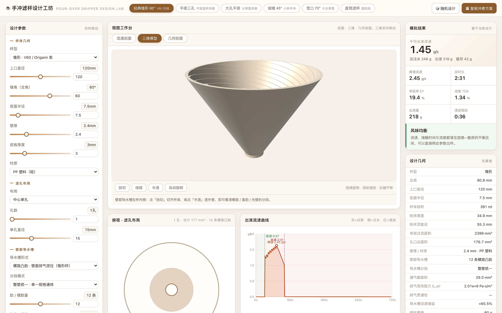
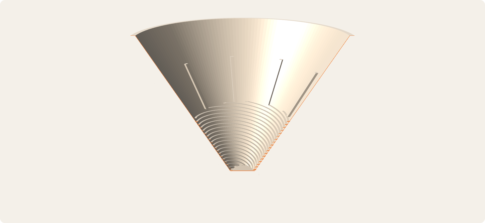
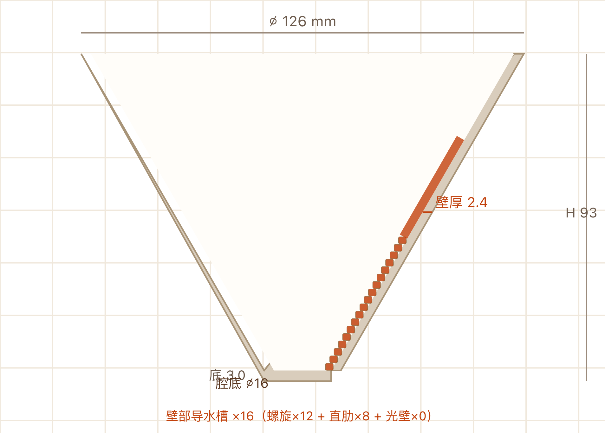
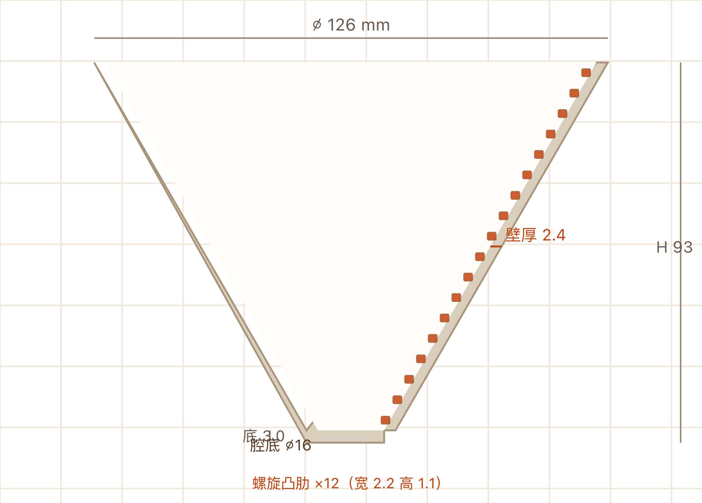

<h1 align="center">☕ Pour-Over Dripper Design Lab</h1>

<p align="center"><strong>手冲滤杯参数化设计工具 · Parametric Coffee Dripper Design Tool</strong></p>

<p align="center">Turning &quot;wall vent channels&quot; from a physics formula into a solid you can print.</p>

<p align="center">
  <a href="LICENSE"></a>
  <a href="THIRD_PARTY_LICENSES.md"></a>
  <a href="index.html"></a>
  <a href="https://github.com/<your-username>/pour-over-dripper-design-lab/actions/workflows/ci.yml">/pour-over-dripper-design-lab/actions/workflows/ci.yml/badge.svg" alt="CI"></a>
  <a href="src/js/"></a>
  <a href="tools/check_geometry.js"></a>
</p>

<p align="center">
  <a href="#quick-start"><strong>Quick start</strong></a> &nbsp;·&nbsp;
  <a href="#features"><strong>Features</strong></a> &nbsp;·&nbsp;
  <a href="#how-it-works"><strong>How it works</strong></a> &nbsp;·&nbsp;
  <a href="#parameters"><strong>Parameters</strong></a> &nbsp;·&nbsp;
  <a href="#printing-guide"><strong>Printing guide</strong></a> &nbsp;·&nbsp;
  <a href="#build-from-source"><strong>Build from source</strong></a> &nbsp;·&nbsp;
  <a href="#faq"><strong>FAQ</strong></a>
</p>

---

<p align="center">
  
</p>

<p align="center">
  <em>Left: design parameters &nbsp;·&nbsp; Centre: 3D model / hole layout / flow-rate curve &nbsp;·&nbsp; Right: simulation results &amp; geometry diagnostics</em>
</p>

---

## What this is

A **zero-dependency, fully offline, pure front-end** parametric design tool for pour-over coffee drippers.

It does three things, and each one goes all the way to the end:

| | What it does | Why you can trust it |
|---|---|---|
| **Simulates** | Darcy seepage + orifice weir flow through the coffee bed → flow rate, clogging time, extraction uniformity | Physical equations in the code, not a hand-waved curve fit |
| **Builds** | The **wall vent channel** as real solid geometry, not a sketch | Channel volume and coverage match the physics model's conductance exactly |
| **Exports** | STL / 3MF / OBJ you can drop into Bambu Studio and slice | Every parameter combination is checked for watertightness and winding consistency |

> **In one line:** most dripper design tools stop at "here's a cross-section". This one goes from a physics model all the way to a **printable file you can hand to a slicer**.

---

## Quick start

`index.html` is a **self-contained single file** — double-click it. No server, no network, no `npm install`.

```bash
git clone https://github.com/<your-username>/pour-over-dripper-design-lab.git
cd pour-over-dripper-design-lab
open index.html          # macOS
# start index.html      # Windows
```

<details>
<summary><b>📦 Just want a model? Download a sample</b></summary>

`samples/` contains a finished model, ready to slice:

| File | Notes |
|---|---|
| [`pour-over-v60-spiral-rib.stl`](samples/pour-over-v60-spiral-rib.stl) | Binary STL · millimetres · Z-up · base on the plate |
| [`pour-over-v60-spiral-rib.3mf`](samples/pour-over-v60-spiral-rib.3mf) | 3MF · drag straight into Bambu Studio |

Classic conical 60°, 120 mm rim, 2.4 mm wall, 3 mm base, 12 spiral ribs at 1.5 turns each.

</details>

---

## Features

### 🧪 Flow physics

Water has to seep through a compacted coffee bed — that's **porous-medium seepage**. The holes in the
floor are **orifice weir flow**. Coupling the two is what determines flow rate and clogging risk.

| Stage | Approach |
|---|---|
| Lateral flow through the bed | Darcy's law; effective permeability varies with compaction and grind |
| Discharge through holes | Torricelli orifice flow, `Q = Cd·A·√(2gh)` |
| Time stepping | Discrete time integration of the bed, **fill → percolate → drain** |
| Venting | Negative pressure in the bag cavity between wall and filter paper, fighting the driving head |
| Channel conductance | Rectangular slot, `G = w·h³ / (12·μ·L)` |
| Channel payoff | **Counterfactual**: remove the channel entirely, recompute, compare flow at the same head |

That last row is the point of the tool: the "*this vent channel improves working-point flow by 65%*"
figure is not an estimate — it's the difference between two runs of the same code path.

### 🌀 Wall vent channels (real geometry, not decals)

| Form | Works on | Physical role | How it's built |
|---|---|---|---|
| **Spiral rib** | Conical (only tapered walls form the bag cavity) | Vents the wall cavity, breaks the sealed pocket | Rectangular-section ridge spiralling along the wall, protruding into the cavity |
| **Radial groove** | Flat / cylindrical base (nothing to mill on a cone) | Distributes flow across the base, cuts lateral resistance | Radial pocket milled *inside* the base solid |
| **Segmented mode** | Conical | Per-segment spiral / straight rib / smooth wall along the generatrix | Built per segment, seamlessly joined at the seams |

**Why segments must stay continuous**

The venting path is in **series** along the wall. Negative pressure under the bed has to travel all
the way to the rim, so total vent resistance is the *sum* of segment resistances. **A single
smooth-wall segment becomes a bottleneck and chokes the entire path.** The diagnostics panel breaks
the resistance down per segment.

<p align="center">
  
  <br>
  <em>Segmented mode, cut away: spiral ridge below · straight ribs in the middle · smooth wall on top</em>
</p>

<p align="center">
  
  <br>
  <em>Matching geometry section: spiral = discrete blocks · straight = continuous band · smooth = nothing</em>
</p>

### 🧊 3D view

Native WebGL, hand-written — **no three.js, no graphics library**:

- Orbit camera — drag to rotate, wheel to zoom, right-drag to pan
- **Cutting plane** with a slider — slice the body open to inspect the wall channels
- Wireframe / transparent / auto-rotate
- **Flat shading** — per-face normals, so hard edges don't get averaged into mush by shared vertices

> Wall channels live on the **inside** of the cup — you won't see them without cutting or transparency.
> The first time you enable segmented mode, the cutting plane opens automatically.

### 📐 Geometry section view

Dimensioned section of the **printable solid** (not the flow schematic): outer diameter, height, base
thickness, wall thickness, cavity-floor diameter, hole specs, per-segment channel specs.

<p align="center">
  
</p>

### 🖨️ 3D-printing handoff

- **Print panel**: model volume, surface area, bounding box, triangle count, **mesh integrity badge**
- **Slicing advice**: orientation, whether supports are needed, layer height / wall loops / material / filament estimate
- **Export**: **STL** (binary, mm, Z-up, base on the plate) · **3MF** (opens straight in Bambu Studio) · **OBJ**

---

## How it works

### ① The bed: Darcy seepage

The bed is treated as an isotropic porous medium. Lateral resistance comes from Darcy's law:

```text
Q = k·A·ΔP / (μ·L)
```

Effective permeability `k` is **not** constant — it shrinks as the bed compacts and the grind gets
finer. Slower lateral gathering means dead zones at the base and uneven extraction.

### ② The holes: orifice weir flow

Flow through each hole is orifice-controlled (Torricelli):

```text
Q = Cd·A·√(2gh)
```

with `Cd ≈ 0.62`. Smaller and fewer holes mean slower discharge at the same head — the direct
reason "fine grind + too few holes" clogs.

### ③ Venting: bag-cavity vacuum vs driving head

On a conical cup the filter paper hugs the wall and forms a **sealed pocket**. Water pushing out of
the bed has to squeeze the air out of that pocket first, generating negative pressure `p_vent`.

That vacuum **cancels part of the driving head**:

```text
Q_work = f( H_drive − p_vent )
```

Which is exactly the familiar gurgling stall: during the bloom the bed swells, pushes the air out,
and the resulting vacuum holds the water back.

### ④ The channel: venting that vacuum away

The wall channel opens a path to atmosphere, pulling `p_vent` back toward zero.

- **Spiral rib** — holds a circumferential slot between wall and paper; long vent path (high
  resistance) but covers the whole wall
- **Straight rib** — runs straight to the rim; short path (low resistance) but limited area
- **Smooth wall** — no channel, only the paper-to-wall contact gap; highest resistance

### ⑤ The counterfactual: what is the channel actually worth?

The most convincing step in the whole tool:

```
with channel    →  run the full model  →  Q_with
channel removed →  run the full model  →  Q_without

channel payoff = Q_with / Q_without − 1
```

Both runs take the **identical code path**; the only difference is that the channel's geometry
parameters are zeroed. So the difference is a measurement, not an estimate.

---

## Mesh quality guarantees

Geometry like this is easy to get "looks right, explodes in the slicer". Every parameter combination is
topology-checked:

| Check | Meaning | Why it matters |
|---|---|---|
| Open edges = 0 | No exposed boundaries | The slicer flags these as holes |
| Non-manifold edges = 0 | Every undirected edge is shared by exactly 2 triangles | 3+ faces on an edge = self-intersecting solid |
| **Directed-edge conflicts = 0** | Every directed edge appears exactly once | **Consistent winding** (see below) |
| Degenerate triangles = 0 | No zero-area faces | Breaks normal computation |
| Normal agreement = 100% | Stored face normal matches the cross product | Determines how the slicer reads inside vs outside |

> The *directed-edge* check was added later. Checking only "each edge used twice" misses meshes with
> **self-contradictory winding**: they look closed topologically, but the computed volume comes out
> several times too large and the slicer produces a solid lump. This bug was real, and no amount of
> staring at the render would have caught it.

**16 built-in validation scenarios** (6 presets + segmented channels / deep & shallow grooves / coarse
& fine spirals / extreme cone angles / single large hole / dense hole ring):

```bash
node tools/check_presets.js     # 6 built-in presets
node tools/check_geometry.js    # 16 extended scenarios
```

```
case                     tris    open over degen dconf   vol(cm3) normalBad
  OK  锥形 默认              30252      0    0     0     0      60.2        0
  OK  锥形 三段真实            31516      0    0     0     0      59.1        0
  OK  平底 径向铣槽            17648      0    0     0     0      56.1        0
  ...
ALL PASS
```

---

## Parameters

### Body geometry

| Parameter | Range | Notes |
|---|---|---|
| Shape | Cone / flat / cylinder | Cone = V60, Origami; flat = Kalita, Chemex; cylinder = straight-sided |
| Rim diameter | 60–180 mm | Inner diameter at the rim |
| Cone angle (full) | 20–80° | Cone only. V60 is 60°, Origami ~45° |
| Base radius | 3–45 mm | Non-cylinder only; raised to clear the hole ring |
| Flat depth | 0–30 mm | Flat only |
| Wall tilt | 2–35° | Flat only |
| Cylinder height | 40–150 mm | Cylinder only |
| Wall thickness | 0.5–8 mm | **Normal** thickness (sloped walls get horizontal compensation) |
| Base thickness | 1–10 mm | Groove mode needs headroom: pit floor ≥ 0.6 mm |
| Material | PP / PET / glass / ceramic / steel / titanium | Drives weight and heat estimates |

### Hole layout

| Parameter | Range | Notes |
|---|---|---|
| Layout | Single / ring / cluster | |
| Hole count | 1–24 | |
| Hole diameter | 2–40 mm | Keep ≥ 1.0 mm (2.5× a 0.4 nozzle) |
| Ring radius | 0–40 mm | Non-single layouts |

### Wall vent channel

| Parameter | Range | Notes |
|---|---|---|
| Form | None / spiral rib / radial groove | The tool explains why a form doesn't fit the current shape |
| Segment mode | Single / segmented | Per-segment specs in segmented mode |
| Rib / groove count | 0–24 | |
| Width | 0.5–8 mm | **Circumferential** footprint |
| Height / depth | 0.2–4 mm | Below 0.8 mm the paper may press flat — the tool warns |
| Spiral turns | 0.5–3 | Turns per rib |

**Segment structure** (segmented mode only): per segment you can set `shape`
(spiral / straight / smooth), `start` & `end height`, `count`, `width`, `height`, `turns`, plus
quick templates like "spiral below, straight above".

### Coffee & brewing

Dose 6–40 g · Grind 0–100 · Ratio 8–25 g/g · Bloom water 0–6× dose · Bloom time 0–120 s ·
Pour segments 1–6 · Total pour time 10–240 s · Water temp 80–100 °C

> These **don't affect geometry** — they only drive the flow simulation, for answering "does this cup
> shape work with this dose?"

---

## Printing guide

| Item | Recommendation |
|---|---|
| Orientation | Rim up, base flat on the plate at z=0 |
| Layer height | 0.16–0.20 mm |
| Wall loops | ≥ 3 (matches the 2.4 mm wall in the model) |
| Material | PP (heat-resistant to 100 °C) or PETG; **PLA is unsuitable above 90 °C** |
| Supports | Usually unnecessary for conical cups (max 30° deviation from vertical, within the 45° self-support limit); judge for flat/cylindrical bases |

**Print orientation matters for the channels**: the ribs protrude about 1 mm. With the rim up and ribs
facing inward, the filter paper settles against the wall and forms the very pocket the channel is
there to vent.

---

## FAQ

<details>
<summary><b>Why not three.js?</b></summary>

To keep `index.html` a **genuine single file**. Using three.js means a CDN reference (breaking offline
use) or ~600 KB of library stuffed into the file. A hand-written renderer is 450 lines and gives exact
control over flat shading and the cutting plane — the two things that are fiddliest to get right in a
general-purpose engine.

</details>

<details>
<summary><b>Are the physics and geometry models the same model?</b></summary>

**Yes**, deliberately:

- Physics side: rib width is a **circumferential footprint** (`freeW = perimeter − count × width`);
  material volume is `Σ count × width × height × path length`
- Geometry side: the mesh is built from **equal-height horizontal slices**, each occupying exactly
  `width` of circumferential arc

If the geometry instead swept a rectangle perpendicular to the spiral path, the volume would come out
$1/\cos(\text{spiral angle})$ too small and no longer match the model — the print would weigh less
than expected and vent worse than predicted.

</details>

<details>
<summary><b>Why segment the vent channel?</b></summary>

Because the vent path is in **series**. With one uniform spec, a spiral rib's path is long (high
resistance). "Spiral below, straight above" gives the straight segment a direct run to the rim — low
resistance — and the bottleneck disappears.

The cost: a single smooth-wall segment ruins the whole path, because the weakest link sets the total
resistance in a series circuit. Segment mode lets you **locate and eliminate the bottleneck segment
precisely**.

</details>

<details>
<summary><b>I can't see the wall channels — they're inside the cup</b></summary>

Hit **「剖切」 (Cut)** in the toolbar (it has a slider) or **「半透」 (Transparent)**.
The first time you enable segmented mode, the cut opens automatically. The **Geometry section** tab
always shows the inner wall in 2D regardless of viewing angle.

</details>

<details>
<summary><b>What happens when the channel doesn't fit the shape?</b></summary>

The physics model states the reason and disables the build:

- A spiral rib needs a **tapered wall** to form a pocket — on a straight-walled cylinder it can't vent
- A radial groove is milled into the **base** — a cone tapers to a point, leaving nowhere to mill

The tool explains this in the channel diagnostics panel rather than silently building useless geometry.

</details>

<details>
<summary><b>Can I print it in Bambu Studio?</b></summary>

Yes. Hit **「⬇ 3MF」**. The exported `.3mf` is standard 3MF (ZIP + `3D/3dmodel.model` + correct XML
namespace + valid index range) and drops straight into Bambu Studio.

STL works too, but carries no slicing settings (set layer height and wall loops in your slicer).

</details>

<details>
<summary><b>Will the printed cup actually work?</b></summary>

The tool produces a **design reference**, not a certified product. Verify before use: material heat
resistance, actual strength (depends on layer height, infill and machine precision), and whether the
shape suits your brewing style.

</details>

---

## Build from source

The shipped file is a single HTML assembled from a baseline page plus several source modules. After
editing sources, reassemble:

```bash
python3 tools/assemble.py              # → ./index.html
python3 tools/assemble.py -o dist/x.html

# regression checks (both must be fully green)
node tools/check_presets.js
node tools/check_geometry.js
```

### Layout

```
├── index.html              # self-contained build output (don't hand-edit)
├── docs/                   # README images
├── src/
│   ├── baseline.html       # baseline page skeleton (assembly input)
│   ├── style.css
│   └── js/
│       ├── model_base.js   # physics: seepage / weir flow / channel conductance / segment specs
│       ├── ui_base.js      # parameter panel / section drawing / diagnostics
│       ├── print3.js       # printable solid: shell, holes, spiral ribs, radial grooves
│       ├── view3d.js       # native WebGL renderer (orbit camera / cutting / flat shading)
│       ├── export.js       # STL / 3MF / OBJ writers (3MF = ZIP + CRC32)
│       ├── printadvice.js  # print process assessment
│       ├── v3ext.js        # integration layer for 3D / geometry section / print panel
│       └── earcut.js       # third-party: polygon-with-holes triangulation (ISC)
├── tools/
│   ├── assemble.py             # assemble the single-file build
│   ├── check_presets.js        # mesh validation, 6 presets
│   ├── check_geometry.js       # mesh validation, 16 extended scenarios
│   ├── smoke_test.js           # browser smoke test (Playwright)
│   ├── validate_exports.py     # validate exported STL / 3MF / OBJ
│   ├── render_offline.js       # offline software renderer (no WebGL, outputs PNG)
│   └── capture_docs.js         # regenerate README images
└── samples/                # ready-to-slice sample models
```

### Tech stack

| | |
|---|---|
| Rendering | Native WebGL 1.0 (hand-written matrices/shaders, flat shading) |
| Geometry | Custom revolved shell + earcut polygon-with-holes triangulation |
| Export | Hand-written binary STL / ZIP+CRC32 3MF / OBJ |
| Dependencies | **Zero runtime dependencies** — no framework, no CDN, no build step |
| Runtime | Any modern browser with WebGL |

---

## Contributing

See [CONTRIBUTING.md](CONTRIBUTING.md). Most welcome:

- 🔬 **Extend the physics** — alternative bed-compaction models, filter-paper permeability, temperature
  effects on viscosity
- 🧪 **Add validation scenarios** — turn the traps you've hit into regression tests
- 🌏 **Improve the interface** — Chinese copy polish, other languages
- 🖨️ **Report printability problems** — especially slicer errors

> Before contributing, please read the
> [geometry rules in CONTRIBUTING.md](CONTRIBUTING.md#几何改动必须守住的规矩) — they record several hard
> constraints that are only obvious after you've hit them.

---

## License

MIT — see [LICENSE](LICENSE).

Third-party components: [THIRD_PARTY_LICENSES.md](THIRD_PARTY_LICENSES.md) (earcut · ISC · © Mapbox).

---

## Disclaimer

This tool produces **design references**, not certified products. Verify before use:

- Water above 90 °C deforms PLA; material choice is your responsibility
- Real strength depends on layer height, infill and machine precision
- No shape is guaranteed to suit everyone's brewing style

---

<p align="center">
  <sub>
    Built with ☕ and 🔧 · Issues and PRs welcome
  </sub>
</p>
